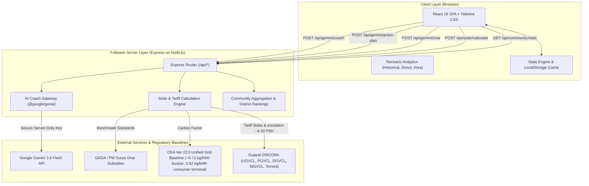

# URJASAATHI – Your Personal Green Energy Companion
### Gujarat Energy Development Agency (GEDA) Mission LiFE Hackathon Submission

**URJASAATHI** (ઊર્જાસાથી) is a full-stack green energy companion web application tailored specifically for households across the 33 districts of Gujarat. Built for the GEDA Mission LiFE initiative, it empowers citizens to monitor their carbon baseline, reduce electric utility bills, participate in daily eco-challenges, consult an AI Green Coach powered by Gemini 3.8 Flash, assess rooftop solar feasibility under PM Surya Ghar Muft Bijli Yojana, and earn a prototype Digital Green Impact Passport.

---

## 🌟 Tech Stack

- **Frontend:** React 19, TypeScript, Tailwind CSS, Recharts for responsive analytics, Lucide Icons, canvas-confetti.
- **Backend:** Node.js, Express (serving API routes and Vite SPA middlewares in development mode on port 3000).
- **AI Intelligence:** `@google/genai` TypeScript SDK (model: `gemini-3.8-flash`) integrated server-side with telemetry (`User-Agent: aistudio-build`) and safe rule-based fallback knowledge engines.
- **Persistence:** Structured client storage with full schema validation and seamless compatibility with Firebase Firestore.
- **Testing:** Native Node.js test runner (`node:test`, `node:assert/strict`) via `npx tsx --test`.

---

## 🏗️ System Architecture (Mermaid)



---

## 📋 Simplified Architecture & Core Sections

The application is structured around a citizen-centric UX paradigm ("5-second clarity: How much power do I use? How much money can I save? What should I do today?"). The interface is organized into **Five Primary Sections** and **One Secondary Section**:

1. **Home (`/` or `?tab=home`)**
   - **5-Second Clarity Dashboard:** Immediate display of Household Green Score (out of 100) with tier and streak counter.
   - **Executive Key Metrics:** Monthly Electricity Consumption (kWh) and Monthly Money Savings Potential (₹).
   - **Today's Priority Action:** Exactly one featured high-impact action with immediate one-click completion and celebratory feedback.
   - **Progressive Disclosure:** Clean 6-month historical consumption trend vs. LiFE benchmark, with deep-links to detailed analytics and community standings.

2. **My Energy (`?tab=my-energy`)**
   - **Executive Energy Summary:** 4 comprehensive metric cards (Monthly kWh, Monthly Bill, Carbon Footprint, Potential Savings) with printable energy report.
   - **Interactive Smart Appliance Energy Calculator:** Real-time formula $\text{kWh} = \text{Watts} \times \text{Hours} \times \text{Days} \div 1000$ with quick presets (170W gaming laptop, 200W cooler, 1.5T AC, 28W BLDC fan, geyser, etc.) and explicit distinction between peak rated capacity and continuous power draw.
   - **Appliance Load Distribution Donut & 6-Month Comparison:** Visual breakdown of major household appliances and historical tracking against LiFE targets.
   - **Transparent Methodology Accordions:** Documented CEA Version 22.0 (0.675 kg CO₂/kWh) baseline and Gujarat DISCOM slab tariffs (UGVCL, PGVCL, DGVCL, MGVCL, Torrent Power).

3. **Green Missions (`?tab=missions`)**
   - **Focused Daily Experience:** Clean top header with streak counter, LiFE points, and featured daily priority.
   - **14 Certified Mission LiFE Challenges:** Categorized into Cooling, Lighting, Appliances, Solar, Habits, and Peak Management.
   - **Science-Backed Impact:** Clear carbon reduction (kg CO₂) and rupee savings metrics for every action.
   - **Progressive Disclosure:** Displays top priority challenges first with a clean toggle to explore all 14 missions.

4. **UrjaGuru AI (`?tab=coach`)**
   - **Conversational Intelligence:** Chat-first dedicated interface powered by Gemini 3.8 Flash via server-side endpoints with multi-turn conversation memory.
   - **Smart Electricity Math:** Dynamically calculates appliance consumption and costs with transparent assumptions.
   - **Continuous vs. Peak Rated Nuance:** Accurately distinguishes peak adapter ratings (e.g. 170W gaming laptop power brick) from actual continuous draw (~100W–130W gaming, ~35W–50W web browsing, ~15W trickle charge, <1W standby).
   - **Trilingual Comprehension:** Fluently understands and responds in English, Hindi, and Gujarati/Hinglish.
   - **Strict Intent Discipline:** Directly addresses the user's specific query without generic or irrelevant inserts.
   - **4 Quick Prompt Chips & Clear History:** Instant access to common appliance questions and one-click chat reset.

5. **Solar & Savings (`?tab=solar`)**
   - **Interactive Rooftop Solar Feasibility:** Configurable inputs for monthly consumption, shadow-free rooftop area, Gujarat district, current bill, DISCOM tariff, and hybrid battery option.
   - **Central Subsidy Modeling:** PM Surya Ghar Muft Bijli Yojana Central Financial Assistance (₹30,000 for 1kW, ₹60,000 for 2kW, ₹78,000 for 3kW+).
   - **Regulatory Compliance:** Integrates GERC Grid Interactive Distributed Renewable Energy Sources (GIDRES) Regulations, 2026 (notified 30 Oct 2026) with explicit ₹2.25/kWh surplus injection compensation.
   - **System Performance Ratio (PR):** Explicit PR (0.825) with configurable system losses (default 17.5%) and PDF feasibility report generation.

6. **Secondary Section: My Impact (`?tab=impact`)**
   - **Achievements & Badges:** Unlocked sustainability milestones and credentials.
   - **Community Leaderboard:** Gujarat-wide green champions with active user rank highlighting and simulated demo cohort labeling.
   - **33-District Rankings:** Performance comparisons across all 33 Gujarat administrative districts.
   - **Green Impact Passport:** Prototype digital sustainability credential (`GEDA-LIFE-GJ-2026-XXXX`) with QR verification code, verified badge roster, and printable card (clearly labeled as a prototype hackathon credential).

---

## 🗄️ Database & Schema Specifications

```typescript
// Household Assessment Record
export interface HouseholdProfile {
  name: string;
  city: string;
  district: string;            // Validated against 33 Gujarat Districts
  familyMembers: number;       // Range: 1 - 20
  monthlyKwh: number;          // Range: 10 - 5000 kWh
  monthlyBillInr: number;      // Electricity bill in INR
  appliances: string[];        // Array of appliance identifiers
  rooftopAvailableSqFt: number;// Shadow-free terrace area
  hasSolarInstalled?: boolean; // Existing grid-tied solar status
}

// Mission Completion Record
export interface CompletedMissionLog {
  missionId: string;
  completedAt: string;         // ISO 8601 Timestamp
  points: number;
  co2SavedKg: number;
  inrSaved: number;
}

// Master Applet State
export interface AppState {
  profile: HouseholdProfile;
  isOnboarded: boolean;
  completedMissions: Record<string, CompletedMissionLog>;
  streakDays: number;
  lastActiveDate: string;       // YYYY-MM-DD
  badges: string[];
}
```

---

## 🔌 API Documentation

| Method | Endpoint | Description |
|---|---|---|
| `GET` | `/api/health` | Service health, server uptime, and Gemini configuration check |
| `POST` | `/api/gemini/coach` | Evaluates `HouseholdProfile` and returns personalized energy recommendations |
| `POST` | `/api/gemini/action-plan` | Returns a tailored 7-day sustainability sprint |
| `POST` | `/api/gemini/chat` | Conversational Q&A with UrjaGuru regarding tariffs, cooling, and solar |
| `POST` | `/api/solar/calculate` | Computes solar capacity, generation, PM Surya Ghar subsidy, and payback |
| `GET` | `/api/community/stats` | Aggregated district stats, leaderboard, and community challenges |

---

## 🧮 Mathematical Calculations & Audited Standards

### 1. Grid Emission Methodology (CEA Version 22.0 FY 2025-26)
- **Official National Baseline:** The primary household footprint baseline uses the **CEA Version 22.0 FY 2025-26 weighted average emission factor of 0.675 kg CO2/kWh** for the unified Indian Grid.
  $$\text{Household Carbon (kg CO}_2\text{)} = \text{Monthly Consumption (kWh)} \times 0.675\text{ kg CO}_2\text{/kWh}$$
- **Custom Delivery-Loss Adjusted Estimate (Engineering Model):** An optional delivery-loss-adjusted figure of **0.82 kg CO2/kWh** is provided for comparative lifecycle analysis, modeling an assumed ~17.7% Aggregate Technical & Commercial (AT&C) / transmission loss $[0.675 / (1 - 0.177) \approx 0.82]$.
- **Methodology & Source Boundary:** The 0.82 kg CO2/kWh figure is explicitly documented as a custom engineering estimate and is **NOT** labeled as a CEA-published or CEA-verified figure.

### 2. Solar Generation with Explicit Performance Ratio (PR) & System Losses
- **Solar Insolation:** Gujarat receives an average of $5.2\text{ Peak Sun Hours (PSH)/day}$.
- **Configurable System Losses:** Modeled at a default of $17.5\%$ (covering $4\%$ soiling/dust, $8.5\%$ thermal derating, $2\%$ cabling/mismatch, and $3\%$ inverter conversion efficiency).
- **Explicit Performance Ratio (PR):**
  $$\text{PR} = 1 - \frac{\text{System Losses (\%)}}{100} = 1 - 0.175 = 0.825$$
- **Specific Yield & Monthly Generation:**
  $$\text{Daily Specific Yield} = 5.2\text{ PSH/day} \times 0.825\text{ PR} = 4.29\text{ kWh/kW/day}$$
  $$\text{Monthly Generation (kWh)} = \text{Capacity (kW)} \times 4.29 \times 30.42 \approx \text{Capacity (kW)} \times 130\text{ kWh/month}$$

### 3. GERC GIDRES Regulations, 2026 & Surplus Compensation
- **Regulatory Framework:** Gujarat Electricity Regulatory Commission (GERC) notified the *Grid Interactive Distributed Renewable Energy Sources (GIDRES) Regulations, 2026* on **30 October 2026**.
- **Surplus Injection Compensation Rate:** Residential solar rooftop consumers injecting surplus energy into the DISCOM grid receive a regulatory compensation of **₹2.25/kWh**.
- **Crucial Regulatory Distinction from APPC:** The ₹2.25/kWh feed-in rate is an explicit regulatory tariff determined under the GERC GIDRES Regulations, 2026 for distributed consumer generators. It is **expressly distinguished from the DISCOM utility-wide Average Power Purchase Cost (APPC)**, which is the bulk pool purchase price of the distribution licensee.

### 4. PM Surya Ghar: Muft Bijli Yojana Central Financial Assistance (CFA)
- **1 kW System:** ₹30,000 CFA
- **2 kW System:** ₹60,000 CFA (₹30,000/kW for first 2 kW)
- **3 kW & Above:** Flat ₹78,000 CFA (Maximum cap for single residential rooftop connections)
- **Eligibility Conditions:**
  1. Active residential domestic connection with a Gujarat DISCOM (UGVCL, PGVCL, DGVCL, MGVCL, or Torrent Power).
  2. Shadow-free roof area (~100 sq.ft per kW).
  3. Installation through registered empanelled vendors via the National Portal (`pmsuryaghar.gov.in`).
  4. ALMM-listed DCR (Domestic Content Requirement) certified solar PV modules and inverters.
  5. Subsidy credited directly via Direct Benefit Transfer (DBT) to the consumer's bank account following technical feasibility approval and net-meter commissioning.

### 5. Payback Economics Formula
$$\text{Payback (Years)} = \frac{\text{Gross Capital Cost} - \text{PM Surya Ghar Subsidy}}{\text{Annual Electricity Bill Savings}}$$

---

## 🧪 Unit Tests

Run the test suite using Node's built-in test runner:
```bash
npm run test
# Runs:
# 1. src/utils/sustainabilityMath.test.ts (sustainability baselines & solar formulas)
# 2. src/utils/aiCoachPipeline.test.ts (10 conversational test cases & smart math verification)
```

All 15 comprehensive unit tests pass:
- **Case 1:** 170W Gaming Laptop on charger (unit calculation $170\text{W} \times 8\text{h} \div 1000 = 1.36\text{ units}$, rated vs continuous breakdown, and domestic tariff cost).
- **Case 2:** Laptop Charger Idle/Vampire Load when plugged into wall without laptop ($\sim 0.3\text{W} - 1.5\text{W}$, $<0.5\text{ units/month}$).
- **Case 3:** 1.5 Ton Inverter AC electricity consumption and compressor cycling.
- **Case 4:** Hinglish query handling (*"Bhai mera 200W cooler din me 10 ghante chale toh kitna bill aayega?"* $\rightarrow 2.0\text{ units}$, ₹12.50/day).
- **Case 5:** Hindi query handling (*"3kW solar panel lagwane par kitni subsidy milegi Gujarat me?"* $\rightarrow$ ₹78,000 CFA & ₹2.25/kWh surplus injection under GERC GIDRES 2026).
- **Case 6:** Ceiling fan comparison ($75\text{W}$ induction vs $28\text{W}$ BLDC motor).
- **Case 7:** Refrigerator continuous cycling calculation.
- **Case 8:** Electric Geyser consumption ($2000\text{W} \times 1\text{h} \div 1000 = 2\text{ units}$).
- **Case 9:** Standalone mathematical verification across varied wattages.
- **Case 10:** Intent-specific offline fallback handling with explicit engine labeling and zero canned AC replies.
- **Cases 11–15:** CEA Version 22.0 FY 2025-26 weighted average emission factor ($0.675\text{ kg CO}_2\text{/kWh}$), solar sizing, GERC 2026 regulations, and custom system losses.

---

## 🚀 Setup & Execution

1. **Install Dependencies:**
   ```bash
   npm install
   ```

2. **Environment Variables:**
   Create `.env` (optional, for live Gemini integration):
   ```env
   GEMINI_API_KEY="your-gemini-api-key"
   PORT=3000
   ```
   *Note: `.env` and API keys are strictly excluded from git via `.gitignore`.*

3. **Run Development Server:**
   ```bash
   npm run dev
   ```
   The app will start at `http://localhost:3000`.

4. **Build for Production:**
   ```bash
   npm run build
   npm start
   ```

---

## 🔮 Limitations & Future Roadmap

1. **Smart Meter Direct Integration (AMI):** Real-time OAuth connection to Gujarat DISCOM smart meters (UGVCL, PGVCL, DGVCL, MGVCL) for automated 15-minute load profiling.
2. **Automated DBT Application Submission:** Direct integration with the PM Surya Ghar National Portal for automated consumer subsidy registration.
3. **Voice-First Gujarati AI Assistant:** Integration of Gemini Live Audio Streaming allowing Gujarati dialect voice commands for rural households and agricultural users.
4. **IoT Appliance Telemetry:** Real-time smart plug integration for automated phantom load detection.

---

## 📚 Authoritative References

1. **Central Electricity Authority (CEA), Ministry of Power, Govt. of India:** *CO2 Baseline Database for the Indian Power Sector, Version 22.0 (FY 2025-26 Weighted Average: 0.675 kg CO2/kWh).*
2. **Ministry of New and Renewable Energy (MNRE), Govt. of India:** *PM Surya Ghar: Muft Bijli Yojana Operational Guidelines (2024).* [pmsuryaghar.gov.in](https://pmsuryaghar.gov.in)
3. **Gujarat Energy Development Agency (GEDA):** *Surya Gujarat Residential Rooftop Solar Guidelines.*
4. **Gujarat Electricity Regulatory Commission (GERC):** *Grid Interactive Distributed Renewable Energy Sources Regulations, 2026 (Notified on 30 October 2026) — Residential surplus injection compensation at ₹2.25/kWh (expressly distinguished from DISCOM APPC).*
5. **NITI Aayog & MoEFCC, Govt. of India:** *Mission LiFE (Lifestyle for Environment) Global Movement Documents.*
