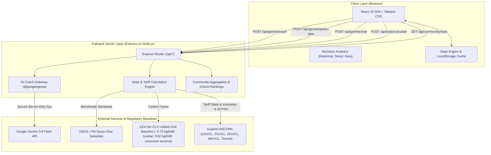

# URJASAATHI – Your Personal Green Energy Companion
### Gujarat Energy Development Agency (GEDA) Mission LiFE Hackathon Submission

**URJASAATHI** (ઊર્જાસાથી) is a full-stack green energy companion web application tailored specifically for households across the 33 districts of Gujarat. Built for the GEDA Mission LiFE initiative, it empowers citizens to monitor their carbon baseline, reduce electric utility bills, participate in daily eco-challenges, consult an AI Green Coach powered by Gemini 3.8 Flash, assess rooftop solar feasibility under PM Surya Ghar Muft Bijli Yojana, and earn a prototype Digital Green Impact Passport.

---

## 🌟 Tech Stack

- **Frontend:** React 19, TypeScript, Tailwind CSS, Recharts for responsive analytics, Lucide Icons, canvas-confetti.
- **Backend:** Node.js, Express (serving API routes and Vite SPA middlewares in development mode on port 3000).
- **AI Intelligence:** `@google/genai` TypeScript SDK (model: `gemini-3.8-flash`) integrated server-side with telemetry (`User-Agent: aistudio-build`) and safe rule-based fallback knowledge engines.
- **Persistence:** Structured client storage with full schema validation and seamless compatibility with Firebase Firestore.
- **Testing:** Native Node.js test runner (`node:test`, `node:assert/strict`) via `npx tsx --test`.

---

## 🏗️ System Architecture (Mermaid)



---

## 📋 Core Modules

1. **Module 1: User Onboarding**
   - Multi-step wizard capturing Household Name, City, Gujarat District (all 33 districts supported), Family Size, Monthly Electricity Consumption (kWh), Average Monthly Bill (₹), Major Appliances, and Shadow-Free Rooftop Area (sq.ft).
   - Real-time preview of calculated baseline Green Score and monthly carbon footprint.
2. **Module 2: Personal Dashboard**
   - Live Green Score meter out of 100 with status tiers (*Urja Ratna*, *Urja Rakshak*, *Prakriti Mitra*, *LiFE Aarambh*).
   - 6 key live metric cards: Green Score, Monthly Carbon (kg CO2), Power Usage (kWh), Energy Saved, Money Saved (₹), Completed Missions & Streak count.
   - Interactive Recharts: 6-month historical consumption vs Mission LiFE target, appliance load distribution donut, and carbon offset trajectory.
3. **Module 3: AI Green Coach (UrjaGuru)**
   - Powered by Gemini 3.8 Flash through server-side endpoints.
   - Generates personalized recommendations quantifying monthly kWh and ₹ saved.
   - Generates customized 7-Day Green Action Plan checklists.
   - Interactive "Ask UrjaAI" conversational assistant answering questions on Gujarat DISCOM tariffs and PM Surya Ghar subsidies.
   - Automatic fallback to high-quality GEDA knowledge engine if API keys are not supplied.
4. **Module 4: Daily Green Missions**
   - 14 interactive sustainability challenges with difficulty ratings, points, and carbon metrics.
   - Confetti celebration, haptic/visual completion feedback, category filtering, and streak counter.
5. **Module 5: Rooftop Solar Calculator**
   - Configurable inputs: consumption, rooftop area, Gujarat district, current bill, tariff rate, hybrid battery option.
   - Recommends PV capacity (kW), monthly generation (kWh), PM Surya Ghar Central Financial Assistance (₹30,000 for 1kW, ₹60,000 for 2kW, ₹78,000 for 3kW+), net investment cost, annual savings, and payback period (~2.9 - 4.5 years in Gujarat).
   - Includes transparent formula disclosures, eligibility conditions, source references, and PDF feasibility report generation.
6. **Module 6: Community & Leaderboard**
   - Gujarat-wide green champions leaderboard with user rank highlighting (`#12 YOU`).
   - Clear distinction between real user data (`● Real User (Active)`) and simulated demonstration cohort profiles (`Simulated Demo Data`).
   - 33-district comparison (Ahmedabad, Surat, Vadodara, Rajkot, Gandhinagar, Bhavnagar, Kutch, etc.).
   - Interactive Community Drives (*Gujarat 24°C Summer AC Drive*, *Terrace Solar Survey Sprint*) with progress tracking.
7. **Module 7: Green Impact Passport**
   - Prototype digital sustainability credential with unique ID (`GEDA-LIFE-GJ-2026-XXXX`).
   - Clearly labeled as a demonstration concept model for the GEDA Mission LiFE Hackathon (not an officially issued government certificate).
   - Quantified impact credentials: Green Score, CO2 eliminated, money saved, tree equivalent.
   - Verified LiFE badges showcase with unlock conditions, simulated QR verification, and printable/exportable card.

---

## 🗄️ Database & Schema Specifications

```typescript
// Household Assessment Record
export interface HouseholdProfile {
  name: string;
  city: string;
  district: string;            // Validated against 33 Gujarat Districts
  familyMembers: number;       // Range: 1 - 20
  monthlyKwh: number;          // Range: 10 - 5000 kWh
  monthlyBillInr: number;      // Electricity bill in INR
  appliances: string[];        // Array of appliance identifiers
  rooftopAvailableSqFt: number;// Shadow-free terrace area
  hasSolarInstalled?: boolean; // Existing grid-tied solar status
}

// Mission Completion Record
export interface CompletedMissionLog {
  missionId: string;
  completedAt: string;         // ISO 8601 Timestamp
  points: number;
  co2SavedKg: number;
  inrSaved: number;
}

// Master Applet State
export interface AppState {
  profile: HouseholdProfile;
  isOnboarded: boolean;
  completedMissions: Record<string, CompletedMissionLog>;
  streakDays: number;
  lastActiveDate: string;       // YYYY-MM-DD
  badges: string[];
}
```

---

## 🔌 API Documentation

| Method | Endpoint | Description |
|---|---|---|
| `GET` | `/api/health` | Service health, server uptime, and Gemini configuration check |
| `POST` | `/api/gemini/coach` | Evaluates `HouseholdProfile` and returns personalized energy recommendations |
| `POST` | `/api/gemini/action-plan` | Returns a tailored 7-day sustainability sprint |
| `POST` | `/api/gemini/chat` | Conversational Q&A with UrjaGuru regarding tariffs, cooling, and solar |
| `POST` | `/api/solar/calculate` | Computes solar capacity, generation, PM Surya Ghar subsidy, and payback |
| `GET` | `/api/community/stats` | Aggregated district stats, leaderboard, and community challenges |

---

## 🧮 Mathematical Calculations & Audited Standards

### 1. Grid Emission Methodology (CEA Version 22.0)
- **National Synchronous Grid:** Under India's "One Nation, One Grid" architecture, regional grids operate synchronously.
- **Busbar Baseline Factor:** The latest Central Electricity Authority (CEA) CO2 Baseline Database Version 22.0 reports a national weighted average baseline emission factor of approximately **~0.72 kg CO2/kWh** (net generation at power station busbar).
- **Effective Consumer Terminal Factor:** When calculating consumer-level end-use electricity reduction, transmission & distribution (T&D / AT&C) losses of approximately ~15% and marginal thermal peak displacement are accounted for, resulting in an effective terminal displacement factor of **0.82 kg CO2/kWh**.
- **Transparency Notice:** This derived end-use displacement figure is clearly documented in the applet as an engineering model factor and is not mislabeled as an officially published standalone regional tariff mandate.

### 2. PM Surya Ghar: Muft Bijli Yojana Central Financial Assistance (CFA)
- **1 kW System:** ₹30,000 CFA
- **2 kW System:** ₹60,000 CFA (₹30,000/kW for first 2 kW)
- **3 kW & Above:** Flat ₹78,000 CFA (Maximum cap for single residential rooftop connections)
- **Eligibility Conditions:**
  1. Active residential domestic connection with a Gujarat DISCOM (UGVCL, PGVCL, DGVCL, MGVCL, or Torrent Power).
  2. Shadow-free roof area (~100 sq.ft per kW).
  3. Installation through registered empanelled vendors via the National Portal (`pmsuryaghar.gov.in`).
  4. ALMM-listed DCR (Domestic Content Requirement) certified solar PV modules and inverters.
  5. Subsidy credited directly via Direct Benefit Transfer (DBT) to the consumer's bank account following technical feasibility approval and net-meter commissioning.

### 3. Solar Feasibility & Payback Economics in Gujarat
- **Solar Insolation:** ~4.33 Peak Sun Hours (PSH)/day (generating ~130 units/kW/month, ~1560 units/kW/year).
- **Average DISCOM Tariff:** Assumed baseline average of ₹6.25/kWh (configurable).
- **Surplus Grid Feed-in:** Excess power exported to DISCOM is credited at the GERC APPC benchmark rate of ~₹2.25/unit.
- **Benchmark Capital Cost:** ~₹58,000/kW gross benchmark before subsidy.
- **Payback Period Formula:**
  $$\text{Payback (Years)} = \frac{\text{Gross Capital Cost} - \text{PM Surya Ghar Subsidy}}{\text{Annual Electricity Savings}}$$

---

## 🧪 Unit Tests

Run the test suite using Node's built-in test runner:
```bash
npm run test
# OR
npx tsx --test src/utils/sustainabilityMath.test.ts
```

All 5 core test suites pass verifying per-capita calculations, edge case usage, solar capacity sizing, subsidy caps, and CEA emission factors.

---

## 🚀 Setup & Execution

1. **Install Dependencies:**
   ```bash
   npm install
   ```

2. **Environment Variables:**
   Create `.env` (optional, for live Gemini integration):
   ```env
   GEMINI_API_KEY="your-gemini-api-key"
   PORT=3000
   ```
   *Note: `.env` and API keys are strictly excluded from git via `.gitignore`.*

3. **Run Development Server:**
   ```bash
   npm run dev
   ```
   The app will start at `http://localhost:3000`.

4. **Build for Production:**
   ```bash
   npm run build
   npm start
   ```

---

## 🔮 Limitations & Future Roadmap

1. **Smart Meter Direct Integration (AMI):** Real-time OAuth connection to Gujarat DISCOM smart meters (UGVCL, PGVCL, DGVCL, MGVCL) for automated 15-minute load profiling.
2. **Automated DBT Application Submission:** Direct integration with the PM Surya Ghar National Portal for automated consumer subsidy registration.
3. **Voice-First Gujarati AI Assistant:** Integration of Gemini Live Audio Streaming allowing Gujarati dialect voice commands for rural households and agricultural users.
4. **IoT Appliance Telemetry:** Real-time smart plug integration for automated phantom load detection.

---

## 📚 Authoritative References

1. **Central Electricity Authority (CEA), Ministry of Power, Govt. of India:** *CO2 Baseline Database for the Indian Power Sector, Version 22.0.*
2. **Ministry of New and Renewable Energy (MNRE), Govt. of India:** *PM Surya Ghar: Muft Bijli Yojana Operational Guidelines (2024).* [pmsuryaghar.gov.in](https://pmsuryaghar.gov.in)
3. **Gujarat Energy Development Agency (GEDA):** *Surya Gujarat Residential Rooftop Solar Guidelines.*
4. **Gujarat Electricity Regulatory Commission (GERC):** *Net Metering Regulations for Grid-Connected Solar PV Systems.*
5. **NITI Aayog & MoEFCC, Govt. of India:** *Mission LiFE (Lifestyle for Environment) Global Movement Documents.*
